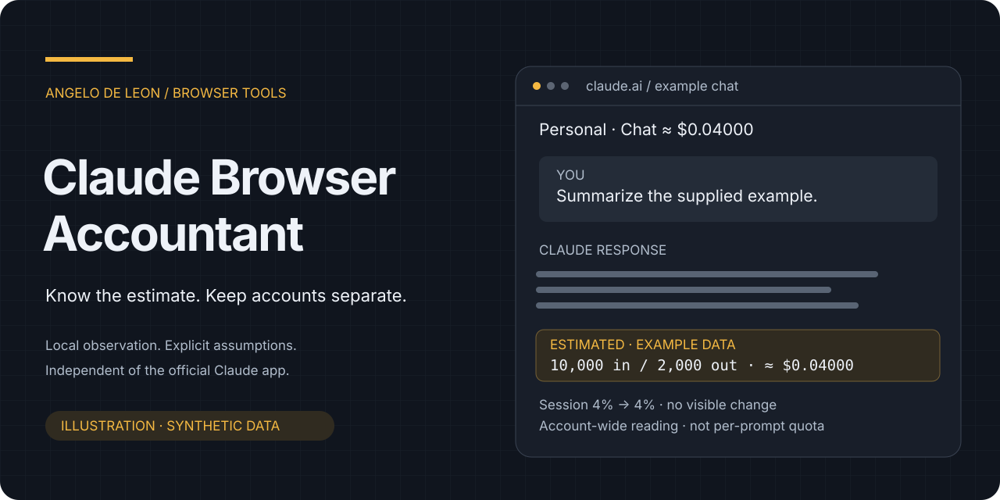
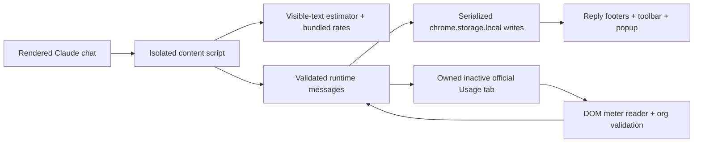

<p align="center"></p>
<p align="center"></p>
<h1 align="center">Claude Browser Accountant</h1>
<p align="center"><strong>Know the estimate. Keep the accounts separate.</strong></p>
<p align="center">A local lens on Claude web chats: see the estimate, follow the plan reading, keep each account separate.</p>
<p align="center">
<a href="https://github.com/RaDeleon/Claude-Browser-Accountant/releases"></a>
<a href="https://github.com/RaDeleon/Claude-Browser-Accountant/actions/workflows/ci.yml"></a>
<a href="https://github.com/RaDeleon/Claude-Browser-Accountant/releases"></a>
<a href="LICENSE"></a>
<a href="https://github.com/RaDeleon/Claude-Browser-Accountant/stargazers"></a>
</p>
<p align="center"><a href="https://github.com/RaDeleon/Claude-Browser-Accountant/releases"></a></p>
<p align="center"><a href="#quick-start">Quick start</a> · <a href="#architecture">Architecture</a> · <a href="docs/PRIVACY.md">Privacy</a> · <a href="docs/VALIDATION.md">Validation</a> · <a href="docs/website/README.md">Portfolio kit</a> · <a href="https://github.com/RaDeleon/Claude-Browser-Accountant/issues">Issues</a></p>
<p align="center"></p>



> **Experimental preview.** Token counts are visible-text estimates. API-equivalent prices are not a subscription bill or a measurement of Team-plan consumption. Independent project; not affiliated with Anthropic.

## Why I built it

Claude's normal web chat does not provide the per-response input/output accounting I wanted. I also wanted to keep personal and work activity separate and see what changed in the official usage page without turning a rounded percentage into a false per-prompt measurement.

Claude Browser Accountant puts those signals beside the conversation, keeps their definitions visible, and stores only local numeric records and scope metadata.

## Features

| Feature | What it does |
| --- | --- |
| Response footer | Estimated input, output, total tokens, selected model and standard API-equivalent cost. |
| Running chat totals | Persists tracked replies and retries without recounting a page reload. |
| Organization separation | Separate ledgers and controls keyed by the active organization and chat IDs. |
| Plan readings | Reads official session/all-model weekly meters through inactive helper tabs. |
| Honest deltas | Rejects wrong-org, stale, missing, late and reset-crossing readings. A 0 pp change means no visible change. |
| Local controls | Label an organization, pause/resume, refresh plan usage or export numeric chat records. |

## Quick start

**Requirements:** BrowserOS Neo or another Chromium browser with unpacked-extension support, plus an existing Claude.ai login. Live browser acceptance was performed in Neo; other browsers are compatibility targets, not independently verified here.

1. Download the ready-to-load extension ZIP from [Releases](https://github.com/RaDeleon/Claude-Browser-Accountant/releases), or clone this repo.
2. Extract the package. Open the browser's Extensions page and enable **Developer mode**.
3. Select **Load unpacked**, then choose the `extension/` folder.
4. Open or reload an ordinary chat on `https://claude.ai/` and submit a new prompt.
5. Use the popup to label each organization **Personal** or **Work**. Labels do not merge records.

```sh
git clone https://github.com/RaDeleon/Claude-Browser-Accountant.git
cd Claude-Browser-Accountant
node --test tests/*.test.cjs
python3 script/package.py
```

The archive contains the `extension/` directory, README and license. It is not a Chrome Web Store listing. Existing replies and replies already running when the extension loads are not backfilled.

### Session and weekly readings

After a tracked reply, the extension can show a before/after reading such as **Session 4% → 4% · 0 pp**, with a separate weekly reading. These are account-wide observations. Other tabs, Code, Desktop activity, rounding and reporting lag affect them.

The sampler opens an inactive official `https://claude.ai/settings/usage` tab, reads its labeled meters and reset text, validates the active organization, then closes its own tab. The official page makes its normal Claude requests; extension code makes no direct network calls or internal-API requests. Automatic checks can be disabled per organization.

A before reading must precede submission and be at most five minutes old. Missing, late or stale readings become **change unavailable**. Decreases or changed reset text become **reset/limit changed**, not negative consumption. No token-to-plan-percentage conversion is invented.

## What the numbers mean

| Signal | Useful for | It does not establish |
| --- | --- | --- |
| Visible-text token estimate | Comparing the text this page exposes | Exact provider tokens or hidden context |
| API-equivalent dollars | A consistent hypothetical list-price comparison | Your subscription bill or remaining allowance |
| Session/weekly plan reading | Seeing the official account-wide rounded meter | Exact consumption attributable to one reply |
| Personal/Work scope | Keeping separate local ledgers by organization | A central admin report or teammate telemetry |

## When something looks wrong

<details><summary><strong>No footer or the total did not move</strong></summary>

Reload the Claude chat after loading/updating the extension. The extension watches new replies; it does not reconstruct spending from old messages. Let the reply settle and confirm tracking is enabled for the active organization. A changed Claude layout can require an extension update; report it without including a private chat export.

</details>

<details><summary><strong>Plan usage shows no change or is unavailable</strong></summary>

Whole-percent rounding can hide a real change. Wrong-organization, stale, missing, reset-crossing and late readings are rejected. Other chats, Desktop or Code activity can change the same account-wide meter. Use the official Usage page to check the current reading; do not treat a missing delta as zero consumption.

</details>

<details><summary><strong>Do personal and work share a total?</strong></summary>

No. The active organization and chat IDs define the ledger scope. Friendly labels make the popup easier to read; renaming an organization does not merge its records. Browser profiles and the separate macOS app have independent local stores.

</details>

## Architecture



| Source | Responsibility |
| --- | --- |
| `extension/content.js` | Submission/retry observation, DOM extraction, response footers and toolbar. |
| `extension/core.js` | Text-size heuristic, model-rate lookup and API-equivalent arithmetic. |
| `extension/background.js`, `store.js` | Sender validation, scope checks, numeric field whitelist and serialized writes. |
| `extension/plan*.js` | Official UI sampling, freshness/reset rules and helper cleanup. |
| `extension/popup.*` | Organization controls and numeric export. |
| `tests/` | Synthetic arithmetic, isolation, persistence, privacy and quota fixtures. |

<details><summary><strong>Accounting boundaries</strong></summary>

The estimate is `ceil(UTF-8 bytes / 4)`, not Claude's tokenizer. Each turn's estimated input includes accessible rendered history again. Hidden instructions, complete project/connector context, images/files, compacted or unrendered history, hidden thinking, cache use and internal multi-step model requests are unavailable. Standard uncached list rates are applied; fast mode, geographic pricing, fees and discounts are not inferred. Unknown models remain **unpriced**. Prices are bundled snapshots, not automatically updated.

The reusable arithmetic core has tests for reported usage and cache categories; that does not mean the browser integration observes those categories. Its live counters remain estimates.

</details>

<details><summary><strong>Permissions and local data</strong></summary>

Manifest V3 requests `storage` and site access only to `https://claude.ai/*`. No debugger, native messaging, password, cookie-API or broad browsing-history permission. Content scripts run in an isolated world. A non-secret organization ID is read from the site to keep scopes separate; credentials are not collected.

Stored fields include opaque IDs, numeric counts/costs, model/rate metadata, timestamps, quota readings/reset labels, local labels and control settings. Conversation text is processed in memory, not saved. The data is local and is not encrypted by this extension. See [PRIVACY](docs/PRIVACY.md).

</details>

## Validation and current limits

**19 offline tests pass** in the prepared source. The predecessor build was live-tested in Neo for response footers, retry accumulation, popup controls, refresh/reopen persistence, official plan readings and helper closure. The publication pass changes branding and removes an owner-specific organization default; it does not claim a fresh live installation of this public identity.

Voice-only submissions, edited/stopped prompts, full browser restart and downloaded export acceptance remain manual. English ordinary-chat UI was tested. Cowork-specific workflows and every browser/locale are not established by these tests. DOM changes can require updates. [Full validation notes](docs/VALIDATION.md).

## Updates and removal

Reload the extension from the Extensions page after a source update, then reload Claude tabs. Review the bundled rate table separately when model prices change. Export records before removing the extension if you want to keep them; browser removal clears that installation's local store. The extension does not modify Claude Desktop or server-side chat history.

## Development and releases

Run the tests before changing the accounting or privacy boundary. GitHub Actions repeats the source checks with read-only repository permissions. The [release guide](docs/RELEASING.md) explains packaging, checksums and how the download badge works. Release downloads count assets fetched from GitHub Releases; they do not count clones, page views, unique people or active installations. No tracking code is added to the product.

The repository includes a [project-page draft, blog post and portable graphics](docs/website/README.md) for the author's portfolio. Artwork is labeled as an illustration with synthetic data rather than a private-chat screenshot.

## License and acknowledgments

[MIT](LICENSE) · Copyright 2026 Angelo De Leon. Claude and Anthropic names identify compatibility; this project is independent and is not endorsed by Anthropic. Technology icons are from [Skill Icons](https://skillicons.dev/), badges from [Shields.io](https://shields.io/), and the cached repository card below from [GitHub Readme Stats](https://github.com/anuraghazra/github-readme-stats). These README services are not runtime dependencies.

## Repository activity

[](https://github.com/RaDeleon/Claude-Browser-Accountant)
